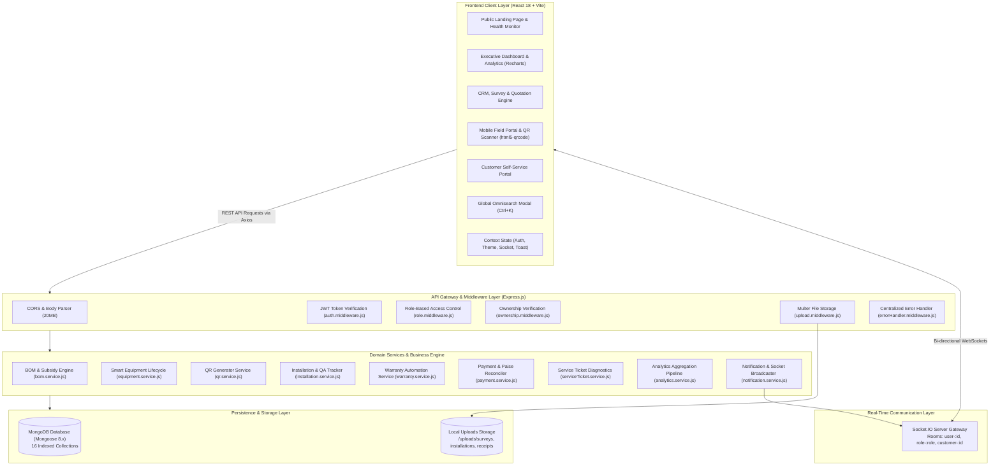
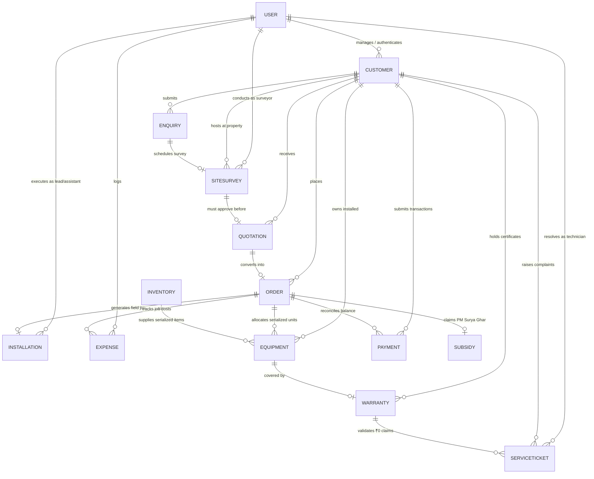
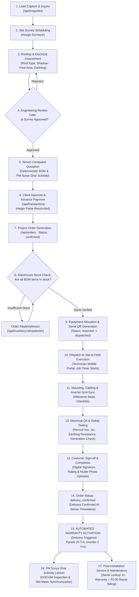

# Solar Installation Management System

<div align="center">


**Enterprise-grade ERP, Field Operations, Smart Equipment Lifecycle & Automated Warranty Management Platform for Solar EPC Businesses**

[](https://nodejs.org/)
[](https://react.dev/)
[](https://expressjs.com/)
[](https://mongoosejs.com/)
[](https://tailwindcss.com/)
[](https://vitejs.dev/)
[](https://socket.io/)
[](#18-license)

[Key Features](#3-key-features) • [System Architecture](#4-system-architecture) • [Installation & Setup](#7-installation--setup) • [API Documentation](#12-api-documentation) • [Workflow](#13-workflow) • [Contributors](#16-contributors)

</div>

---

## 📑 Table of Contents

- [1. Project Header](#1-project-header)
- [2. About the Project](#2-about-the-project)
  - [The Problem It Solves](#the-problem-it-solves)
  - [Target Personas](#target-personas)
  - [Core Objectives](#core-objectives)
- [3. Key Features](#3-key-features)
- [4. System Architecture](#4-system-architecture)
  - [Layered Architecture Diagram](#layered-architecture-diagram)
  - [Architecture In Detail](#architecture-in-detail)
- [5. Technology Stack](#5-technology-stack)
- [6. Project Structure](#6-project-structure)
- [7. Installation & Setup](#7-installation--setup)
  - [Prerequisites](#prerequisites)
  - [Repository Cloning](#repository-cloning)
  - [Quick Start (Root Workspace)](#quick-start-root-workspace)
  - [Manual Setup (Separate Terminals)](#manual-setup-separate-terminals)
  - [Database Seeding](#database-seeding)
  - [Local Development URLs](#local-development-urls)
- [8. Environment Variables](#8-environment-variables)
- [9. User Roles & Permissions](#9-user-roles--permissions)
  - [Role-Permission Matrix](#role-permission-matrix)
  - [Pre-Seeded Demonstration Accounts](#pre-seeded-demonstration-accounts)
- [10. Database Design & Models](#10-database-design--models)
  - [Mongoose Data Models](#mongoose-data-models)
  - [Entity-Relationship Diagram](#entity-relationship-diagram)
- [11. Application Screenshots](#11-application-screenshots)
- [12. API Documentation](#12-api-documentation)
- [13. Solar Installation Lifecycle Workflow](#13-solar-installation-lifecycle-workflow)
  - [Lifecycle Flowchart](#lifecycle-flowchart)
  - [Core Business Rules Enforced](#core-business-rules-enforced)
- [14. Security & Data Integrity](#14-security--data-integrity)
  - [Implemented Security Controls](#implemented-security-controls)
  - [Recommended Security Enhancements](#recommended-security-enhancements)
- [15. Future Improvements](#15-future-improvements)
- [16. Contributors](#16-contributors)
- [17. Contribution Guidelines](#17-contribution-guidelines)
- [18. License](#18-license)
- [19. Contact & Acknowledgements](#19-contact--acknowledgements)

---

## 1. Project Header

The **Solar Installation Management System** (SunPower Solutions) is an end-to-end Engineering, Procurement, and Construction (EPC) operations platform designed specifically for rooftop solar installers, commercial EPC contractors, field engineers, and distributed solar clients.

Built on a decoupled full-stack architecture (**React 18 + Express.js + MongoDB + Socket.IO**), the system streamlines the solar installation lifecycle: from lead capture and on-site engineering surveys to server-computed Bill of Materials (BOM), QR-tracked hardware dispatch, mobile technician commissioning, PM Surya Ghar subsidy tracking, delivery-triggered warranty activation, and post-installation service desk claims.

---

## 2. About the Project

### The Problem It Solves

Rooftop solar installations involve complex, multi-party coordination:
- **Disjointed Hand-offs:** Sales reps quote capacities without knowing roof structural limits; surveyors gather data on paper; warehouse teams dispatch random serial numbers without linking them to specific order warranties.
- **Financial Calculation Inconsistencies:** Client quotes often fail to reflect the dynamic central subsidy slabs under schemes like **PM Surya Ghar: Muft Bijli Yojana**, causing payment disputes and balance reconciliation errors.
- **Warranty & Serial Chaos:** Inverters, solar panels, and batteries have varying warranty lifetimes (2 to 20 years). Without serialized tracking, installers cannot verify if a repair claim is covered, leading to unjustified warranty liabilities or delayed customer support.
- **Unverified Field Commissioning:** Technicians frequently sign off on jobs without recording electrical parameters ($V_{oc}, I_{sc}$, earthing resistance, inverter synchronization), complicating grid interconnection approvals with state distribution companies (DISCOMs).

### Target Personas

| Persona | Primary Needs & Responsibilities | System Interface |
|---|---|---|
| **Administrator / Executive** | Business KPIs, revenue reconciliation, installation pipeline health, inventory thresholds, workforce oversight | Executive Analytics Dashboard, Inventory & Finance Hub |
| **Sales Representative** | Customer CRM, lead qualification, survey scheduling, quotation generation, PM Surya Ghar subsidy guidance | Enquiries Pipeline, Quotation Engine, Customer CRM |
| **Certified Field Technician** | Assigned site jobs, live time-tracking, electrical testing recording ($V_{oc}, I_{sc}$, earthing $\Omega$), photo uploads, customer sign-off | Technician Mobile Portal, QR Equipment Scanner |
| **Solar Customer** | Rooftop installation tracking, invoices, serialized equipment lists, warranty certificate downloads, service requests | Dedicated Customer Self-Service Portal |

### Core Objectives

1. **Enforce Engineering Integrity:** Prevent quotation generation until a site survey has been formally reviewed and approved by engineering.
2. **Deterministic Financials:** Calculate all BOM hardware requirements, central subsidies, gross pricing, advance payments, and order balances on the server.
3. **Hardware Traceability:** Assign uppercase serial numbers and printable QR codes to every major component, tracking status transitions across warehouse, transit, and rooftop installation.
4. **Automated Warranties:** Activate warranties strictly upon confirmed on-site delivery, computing exact expiration dates based on equipment category.
5. **Zero-Cost Service Desk Rules:** Enforce ₹0.00 customer billing for in-warranty service claims while transparently itemizing out-of-warranty repairs.

---

## 3. Key Features

### 🔐 Authentication & Access Control
- **JSON Web Token (JWT) Security:** Stateless bearer authentication with role authorization (`admin`, `sales`, `technician`, `customer`).
- **Role-Based Routing:** Dynamic sidebar navigation filtering, protected workspace routes, and instant demo persona switching (`/api/auth/demo-login/:role`).
- **Data Ownership Guards:** Middleware guarantees that customers can only query their own profiles and technicians can only access assigned installation jobs.

### 📊 Executive Analytics & Real-Time Dashboard
- **Recharts-Powered Visualizations:** 12-month revenue vs. expenses area chart, installation pipeline stage distribution, system capacity distribution (On-Grid, Off-Grid, Hybrid), and service ticket categories.
- **Real-Time KPIs:** Live metric cards tracking total customers, installed solar kW capacity, verified revenue, operating expenses, estimated net profit, pending balances, low-stock alerts, and technician hours.
- **Custom Date Filters:** Flexible time-range filtering (`Full Year`, `H1`, `H2`, `Q3`).

### 👥 Customer Relationship Management (CRM)
- **Comprehensive Customer Profiles:** Stores consumer numbers, sanctioned loads (kW), supply phases (Single/Three), DISCOM utility names, and geocoded installation addresses.
- **Customer 360° History Modal:** Unified view linking customer records to active quotations, orders, payment receipts, installation milestone logs, and equipment warranties.

### 📋 Site Surveys & Engineering Feasibility
- **Structural Assessment:** Roof geometry, roof construction (`flat_rcc`, `sloped_tin`, `clay_tile`, `metal_sheet`, `elevated`), total area, shadow-free area (sq. ft.), tilt angle, and azimuth orientation.
- **Electrical Assessment:** Existing meter type (analog, smart meter, digital bidirectional), sanctioned load, phase, and earthing status.
- **Formal Approval Gate:** Requires explicit engineering approval and recommended capacity (kW) before sales can generate binding quotations.

### 🧮 Smart Quotation & Server-Side BOM Engine
- **Automated Bill of Materials (BOM):** Generates itemized component lists (Tier-1 Mono PERC PV modules, smart grid-tied inverters, lithium battery packs, HDG mounting structures, DC/AC cables, earthing kits).
- **PM Surya Ghar Subsidy Calculations:** Server computes central subsidies based on capacity slabs (up to 2 kW: ₹30,000/kW; 3 kW+: ₹78,000 max).
- **Admin Quotation Editing:** Authorized staff can modify line items, unit prices, transport costs, and custom discounts with instant recalculation.

### 📦 Order & Milestone Project Lifecycle
- **Order Pipeline:** Tracks orders through structured operational stages (`confirmed` $\rightarrow$ `stock_checked` $\rightarrow$ `allocated` $\rightarrow$ `dispatched` $\rightarrow$ `in_installation` $\rightarrow$ `installed` $\rightarrow$ `delivery_confirmed` $\rightarrow$ `completed`).
- **Stock Pre-Check:** Validates warehouse availability before allowing equipment dispatch.
- **Milestone Progress Tracking:** Visual milestone checklist for procurement, dispatch, installation, and inspection.

### 📱 Smart Equipment & QR Code Hardware Lifecycle
- **Serialized Equipment Tracking:** Unique, immutable serial numbers for all panels, inverters, batteries, and structures.
- **Dynamic QR Code Generation:** Server generates Base64 Data URL PNGs and vector SVGs containing component specs and fast lookup URLs.
- **Physical QR Scanner:** Built-in camera scanner powered by `html5-qrcode` for instant on-site equipment lookup and verification.
- **Lifecycle State Machine:** Enforces transitions across `in_stock` $\rightarrow$ `reserved` $\rightarrow$ `dispatched` $\rightarrow$ `installed` $\rightarrow$ `under_service` with immutable movement audit trails.

### 🏭 Warehouse Inventory Management
- **Stock Oversight:** Real-time visibility into current stock, reserved stock, and available stock.
- **Automated Reorder Alerts:** Visual badges and dashboard warnings when stock drops below defined reorder levels.
- **Restock & Replenish Workflows:** Modal for rapid inventory additions and cost/selling price tracking.

### 🛠️ Mobile-Optimized Technician Field Portal
- **Field-Ready UI:** Responsive touch interface designed for smartphones and tablets on job sites.
- **Server-Governed Job Timer:** Starts and records actual working hours from server timestamps.
- **Electrical Quality Assurance Checklist:** Records open-circuit voltage ($V_{oc}$), short-circuit current ($I_{sc}$), inverter grid synchronization status, earthing resistance ($\Omega$), and real-time generation check (kW).
- **Photo Uploads:** Site progress and completion photo capture via Multer storage.
- **Customer Sign-Off:** Digital customer signature capture, rating (1–5 stars), and remarks upon job completion.

### 🛡️ Automated Warranty Management
- **Delivery-Triggered Activation:** Warranties automatically activate upon confirmed delivery (`deliveryConfirmedAt`), preventing premature coverage starts.
- **Category-Based Durations:** Solar PV Panels (240 months / 20 years), Inverters (24 months), Batteries (24 months), Mounting Structures (60 months / 5 years).
- **Serial Eligibility Lookup:** Real-time check returning warranty validity, days remaining, or expiration status.
- **Digital Certificates:** Printable warranty certificates with certificate numbers and coverage terms.

### 🎫 Service Desk & In-Warranty Repair Engine
- **Automated Warranty Verification:** Raising a service ticket automatically checks equipment serial numbers against active warranties.
- **Zero-Charge Warranty Rule:** In-warranty repairs automatically enforce total customer payable at **₹0.00**.
- **Out-of-Warranty Billing:** Itemizes parts replacement and labour costs with transparent pricing.
- **Equipment Status Synchronization:** Moves equipment to `under_service` during repair and restores it to `installed` upon resolution.

### 💰 Financial Management & Cash Flow Reconciliation
- **Integer Paise Arithmetic:** Converts INR values to integer paise during calculations, eliminating JavaScript IEEE-754 floating-point rounding errors.
- **Payment Logging:** Records advance payments, milestone collections, and final settlements with transaction reference validation.
- **Operating Expense Tracking:** Logs hardware procurement, technician labour, transport, liaison, and overhead expenses with receipt attachments.
- **Order Balance Reconciliation:** Automatically adjusts `advancePaid`, `balanceAmount`, and payment status (`advance_paid`, `partially_paid`, `fully_paid`).

### 🏛️ PM Surya Ghar Subsidy Documentation
- **National Portal Tracking:** Tracks applications under PM Surya Ghar: Muft Bijli Yojana.
- **Document Management:** Repository for electricity bills, Aadhaar cards, bank passbooks, roof ownership proofs, and net-meter test reports.
- **DISCOM Coordination Stages:** Tracks progress through application submission, feasibility approval, meter installation, inspection, and direct bank disbursement.

### 📈 Business Reports & CSV Data Export
- **Operational Reports:** Executive financial summaries, project profitability analysis, and technician workload reports.
- **Client-Side CSV Export:** One-click CSV downloads for Financials, Technicians, Installations, Inventory, and Service Tickets.

### 🔔 Real-Time Sockets & Omnisearch
- **Socket.IO Notifications:** Room-based real-time broadcasting to users, roles, and customers upon order creation, dispatch, payment, and job completion.
- **Global Search (`Ctrl+K`):** Instant modal search querying serialized equipment, customer directories, and orders simultaneously.
- **Dual Theme System:** Fully responsive dark/light mode with Midnight navy (`#070b14`), Solar amber (`#f59e0b`), and Electric emerald (`#10b981`) palettes.

---

## 4. System Architecture

### Layered Architecture Diagram



### Architecture In Detail

The system implements a **decoupled, layered enterprise design pattern**:

1. **Client Layer (`frontend/src/`)**: Built with React 18, Vite, and Tailwind CSS. Axios interceptors automatically attach JWT bearer tokens and handle network/auth errors gracefully. Socket.IO client listens for real-time room events.
2. **Gateway & Middleware Layer (`backend/src/middleware/`)**: Centralizes cross-cutting concerns:
   - `auth.middleware.js` verifies JWT signatures and ensures active account status.
   - `role.middleware.js` enforces role-based restrictions.
   - `ownership.middleware.js` guarantees data isolation so customers cannot access external profiles and technicians only see assigned jobs.
   - `upload.middleware.js` uses Multer disk storage, segregating uploads into dedicated directories (`surveys`, `installations`, `services`, `subsidies`, `receipts`) with filename sanitization and MIME-type restrictions.
   - `errorHandler.middleware.js` transforms Mongoose `CastError`, duplicate key `E11000`, and `ValidationError` exceptions into clean, predictable JSON responses.
3. **Controllers Layer (`backend/src/controllers/`)**: Handles HTTP request parsing, sanitization, and standardized response formatting via the `ApiResponse` utility.
4. **Services Layer (`backend/src/services/`)**: Houses all domain business rules, BOM calculation algorithms, equipment movement machines, warranty lifecycle engines, payment reconciliation, and MongoDB aggregation pipelines.
5. **Data Layer (`backend/models/`)**: 16 Mongoose models with strict schema definitions, compound indexes, pre-save hooks, and virtual getters/setters.
6. **Real-Time Sockets (`backend/src/sockets/`)**: Manages room subscriptions (`user-:id`, `role-:role`, `customer-:id`) and broadcasts event notifications across connected sessions.

---

## 5. Technology Stack

### Frontend

| Technology | Version | Purpose |
|---|---|---|
| **React** | `^18.3.1` | Declarative UI component library |
| **Vite** | `^5.4.11` | Next-generation frontend build tooling and HMR dev server |
| **React Router DOM** | `^6.28.0` | Client-side routing, protected routes, and role-based redirects |
| **Tailwind CSS** | `^3.4.15` | Utility-first styling with custom solar color scales and glassmorphism |
| **Lucide React** | `^0.460.0` | Modern, clean vector icon suite |
| **Recharts** | `^2.13.3` | Composable charting library for area, bar, and pie charts |
| **Axios** | `^1.7.7` | Promise-based HTTP client with token and error interceptors |
| **html5-qrcode** | `^2.3.8` | Camera-based QR code scanning for serialized equipment tracking |
| **qrcode.react** | `^4.1.0` | SVG and Canvas QR code rendering on client components |
| **Framer Motion** | `^11.11.17` | Physics-based animations and layout transitions |
| **canvas-confetti**| `^1.9.3` | Milestone celebration animations upon job completion |

### Backend

| Technology | Version | Purpose |
|---|---|---|
| **Node.js** | `>=18.0.0`| Server-side JavaScript runtime environment |
| **Express.js** | `^4.21.1` | Modular REST API routing framework |
| **Socket.IO** | `^4.8.0` | Real-time bi-directional WebSocket communication |
| **Multer** | `^1.4.5-lts.1`| Multipart form-data handling for photo and document uploads |
| **qrcode** | `^1.5.4` | Server-side QR code Data URL (PNG) and vector SVG generation |
| **Morgan** | `^1.10.0` | HTTP request logging middleware |
| **Dotenv** | `^16.4.5` | Environment variable management |

### Database & ORM

| Technology | Version | Purpose |
|---|---|---|
| **MongoDB** | `>=6.0` | Document-oriented NoSQL database |
| **Mongoose** | `^8.24.7` | Object Data Modeling (ODM) library with schema validation and aggregation pipelines |

### Authentication & Security

| Technology | Version | Purpose |
|---|---|---|
| **JSON Web Token (jsonwebtoken)** | `^9.0.2` | Stateless signed token authorization |
| **bcryptjs** | `^2.4.3` | Salted password hashing (10 salt rounds) |
| **CORS** | `^2.8.5` | Cross-Origin Resource Sharing control |

### Development & Testing Tools

| Tool | Purpose |
|---|---|
| **Nodemon** | Development auto-restart utility for backend changes |
| **Postman Collection** | Pre-configured API test suite with environment variables (`postman_collection.json`) |
| **Automated Test Suites**| `testEndpoints.js` (27-step integration test) and `testMasterImprovements.js` |
| **Database Seeder** | `backend/seed/seedLargeData.js` generating 1000+ realistic records and demo accounts |

---

## 6. Project Structure

```
solar-installation-system-odoo-main/
│
├── package.json                         # Monorepo root scripts (dev, build, start)
├── .gitignore                           # Git exclusion rules
│
├── backend/                             # Express.js REST API & WebSocket Server
│   ├── package.json                     # Backend dependencies and scripts
│   ├── server.js                        # Root entry point (delegates to src/server.js)
│   ├── .env.example                     # Environment variable template
│   ├── postman_collection.json          # Postman collection covering all endpoints
│   ├── testEndpoints.js                 # 27-step automated API integration test suite
│   ├── testMasterImprovements.js        # Comprehensive business rule verification suite
│   │
│   ├── models/                          # 16 Mongoose Data Schemas
│   │   ├── User.js                      # User accounts, roles, technician details
│   │   ├── Customer.js                  # Customer CRM, electrical specs, installation address
│   │   ├── Enquiry.js                   # Sales leads, monthly bills, proposed capacity
│   │   ├── SiteSurvey.js                # Rooftop geometry, electrical assessment, approval details
│   │   ├── Quotation.js                 # Itemized BOM, PM Surya Ghar subsidy, pricing totals
│   │   ├── Order.js                     # Order status, equipment allocation, milestone pipeline
│   │   ├── Installation.js              # Scheduled dates, step progress, testing QA, signature
│   │   ├── Equipment.js                 # Serial numbers, QR data, equipment status, audit history
│   │   ├── Warranty.js                  # Certificates, category durations, claims history
│   │   ├── Inventory.js                 # Stock quantities, reorder levels, cost & selling prices
│   │   ├── ServiceTicket.js             # Complaints, diagnosis, warranty status, charges
│   │   ├── Payment.js                   # Transaction receipts, payment types, reconciliation
│   │   ├── Expense.js                   # Procurement, labour, logistics, permits, overheads
│   │   ├── Subsidy.js                   # PM Surya Ghar scheme documentation & DISCOM tracking
│   │   ├── Notification.js              # Persistent user and role notifications
│   │   └── Setting.js                   # Company info, standard rates, subsidy slabs
│   │
│   ├── seed/                            # Database Generation Scripts
│   │   ├── seedData.js                  # Baseline seed script
│   │   └── seedLargeData.js             # 1000+ record realistic dataset with 35+ users
│   │
│   ├── scripts/
│   │   └── markLowStock.js              # Diagnostic script to test inventory threshold triggers
│   │
│   ├── src/                             # Core Application Logic
│   │   ├── app.js                       # Express app configuration & route mountings
│   │   ├── server.js                    # HTTP & Socket.IO server bootstrap
│   │   │
│   │   ├── config/
│   │   │   ├── constants.js             # Enums: ROLES, WARRANTY_DURATIONS, ORDER_STATUS
│   │   │   └── db.js                    # MongoDB Mongoose connection with fallback handling
│   │   │
│   │   ├── controllers/                 # Request Handlers (18 Controllers)
│   │   │   ├── auth.controller.js
│   │   │   ├── customer.controller.js
│   │   │   ├── customerPortal.controller.js
│   │   │   ├── dashboard.controller.js
│   │   │   ├── enquiry.controller.js
│   │   │   ├── equipment.controller.js
│   │   │   ├── installation.controller.js
│   │   │   ├── inventory.controller.js
│   │   │   ├── notification.controller.js
│   │   │   ├── order.controller.js
│   │   │   ├── quotation.controller.js
│   │   │   ├── serviceTicket.controller.js
│   │   │   ├── setting.controller.js
│   │   │   ├── subsidy.controller.js
│   │   │   ├── survey.controller.js
│   │   │   ├── technician.controller.js
│   │   │   ├── transaction.controller.js
│   │   │   └── user.controller.js
│   │   │
│   │   ├── middleware/                  # Custom Express Middleware
│   │   │   ├── auth.middleware.js       # JWT extraction & active account verification
│   │   │   ├── role.middleware.js       # RBAC role guards
│   │   │   ├── ownership.middleware.js  # Customer and technician data ownership
│   │   │   ├── upload.middleware.js     # Multer disk storage and file validation
│   │   │   └── errorHandler.middleware.js # Centralized error normalization
│   │   │
│   │   ├── routes/                      # REST Route Definitions (22 Route Files)
│   │   │   ├── auth.routes.js
│   │   │   ├── customer.routes.js
│   │   │   ├── customerPortal.routes.js
│   │   │   ├── dashboard.routes.js
│   │   │   ├── enquiry.routes.js
│   │   │   ├── equipment.routes.js
│   │   │   ├── expense.routes.js
│   │   │   ├── finance.routes.js
│   │   │   ├── installation.routes.js
│   │   │   ├── inventory.routes.js
│   │   │   ├── notification.routes.js
│   │   │   ├── order.routes.js
│   │   │   ├── quotation.routes.js
│   │   │   ├── report.routes.js
│   │   │   ├── serviceTicket.routes.js
│   │   │   ├── setting.routes.js
│   │   │   ├── subsidy.routes.js
│   │   │   ├── survey.routes.js
│   │   │   ├── technicianPortal.routes.js
│   │   │   ├── transaction.routes.js
│   │   │   ├── user.routes.js
│   │   │   └── warranty.routes.js
│   │   │
│   │   ├── services/                    # Domain Business Logic
│   │   │   ├── analytics.service.js     # MongoDB aggregation pipelines for Recharts
│   │   │   ├── bom.service.js           # Server-side BOM calculation & PM Surya Ghar subsidies
│   │   │   ├── equipment.service.js     # Equipment state machine & movement audit trail
│   │   │   ├── installation.service.js  # Field workflow, electrical QA, technician hours
│   │   │   ├── notification.service.js  # Multi-channel notification dispatch
│   │   │   ├── payment.service.js       # Integer paise arithmetic & balance reconciliation
│   │   │   ├── qr.service.js            # Base64 PNG & SVG QR code generator
│   │   │   ├── serviceTicket.service.js # Automated warranty checks & ₹0 claim billing
│   │   │   └── warranty.service.js      # Delivery-triggered activation & expiry engines
│   │   │
│   │   ├── sockets/
│   │   │   └── socketHandler.js         # Socket.IO connection handling & room management
│   │   │
│   │   ├── utils/
│   │   │   ├── apiResponse.js           # Standardized JSON response envelope
│   │   │   └── currency.js              # Integer paise <-> INR rupee conversions
│   │   │
│   │   └── validators/
│   │       └── input.validator.js       # Declarative request body validation schemas
│   │
│   └── uploads/                         # Static Upload Storage
│       ├── surveys/                     # Rooftop & shading survey photos
│       ├── installations/               # Field mounting & electrical QA photos
│       ├── services/                    # Component defect photos
│       ├── subsidies/                   # PM Surya Ghar verification documents
│       └── receipts/                    # Payment receipts & supplier invoices
│
└── frontend/                            # React 18 Single Page Application
    ├── package.json                     # Frontend dependencies and build scripts
    ├── index.html                       # HTML template with responsive viewport
    ├── vite.config.js                   # Vite configuration with API, upload & socket proxy
    ├── tailwind.config.js               # Tailwind configuration (Solar & Midnight theme)
    ├── postcss.config.js                # PostCSS plugins
    │
    ├── src/
    │   ├── main.jsx                     # React root mount
    │   ├── App.jsx                      # Route definitions, guards & role homes
    │   ├── App.css                      # Global animations & scrollbar styles
    │   ├── index.css                    # Tailwind directives & CSS variables
    │   │
    │   ├── api/
    │   │   └── client.js                # Axios instance with request/response interceptors
    │   │
    │   ├── context/                     # React Context Providers
    │   │   ├── AuthContext.jsx          # User session, JWT storage, role switching
    │   │   ├── ThemeContext.jsx         # Dark / Light theme persistence
    │   │   ├── SocketContext.jsx        # Socket.IO client connection & room joiners
    │   │   └── ToastContext.jsx         # Floating toast alert notifications
    │   │
    │   ├── data/
    │   │   └── demoSession.js           # Offline demo session mock data & fallbacks
    │   │
    │   ├── components/
    │   │   ├── common/
    │   │   │   ├── DemoRoleBar.jsx      # Top active persona indicator & role selector
    │   │   │   └── ErrorBoundary.jsx    # Component failure fallback boundary
    │   │   │
    │   │   ├── layout/
    │   │   │   ├── Layout.jsx           # App shell with Navbar, Sidebar, and Breadcrumbs
    │   │   │   ├── Navbar.jsx           # Top header, search trigger, notifications, profile
    │   │   │   ├── Sidebar.jsx          # Role-filtered collapsible sidebar navigation
    │   │   │   ├── Breadcrumbs.jsx      # Dynamic breadcrumb navigation
    │   │   │   └── GlobalSearchModal.jsx# Ctrl+K omnisearch modal
    │   │   │
    │   │   └── ui/                      # Reusable UI Atoms
    │   │       ├── Badge.jsx
    │   │       ├── Button.jsx
    │   │       ├── Card.jsx
    │   │       ├── Drawer.jsx
    │   │       ├── EmptyState.jsx
    │   │       ├── ErrorState.jsx
    │   │       ├── FilterPanel.jsx
    │   │       ├── Input.jsx
    │   │       ├── Modal.jsx
    │   │       ├── Pagination.jsx
    │   │       ├── SearchBar.jsx
    │   │       ├── Select.jsx
    │   │       └── SkeletonLoader.jsx
    │   │
    │   └── pages/                       # Application Views
    │       ├── LandingPage.jsx          # Public landing page with live system health check
    │       ├── AdminDashboard.jsx       # Executive KPI dashboard with Recharts
    │       ├── CustomersView.jsx        # Customer CRM & 360° modal history
    │       ├── EnquiriesView.jsx        # Lead capture & survey scheduling
    │       ├── SurveysView.jsx          # Site surveys & engineering approval gate
    │       ├── QuotationsView.jsx       # Quotation engine, BOM calculator, printable view
    │       ├── OrdersView.jsx           # Order milestones, stock check, dispatch modal
    │       ├── SmartEquipmentView.jsx   # QR scanner, serial generator, movement history
    │       ├── InventoryView.jsx        # Warehouse stock, low stock alerts, restock modal
    │       ├── TechnicianMobilePortal.jsx# Mobile field portal, job timer, QA tests, sign-off
    │       ├── InstallationPipelineView.jsx# Field installation milestone pipeline
    │       ├── WarrantyManagementView.jsx# Warranty certificates, serial lookup, status badges
    │       ├── ServiceTicketsView.jsx   # Service desk, automatic diagnosis, ₹0 billing
    │       ├── CustomerPortal.jsx       # Customer self-service rooftop tracker
    │       ├── FinancialsView.jsx       # Reconciled payments, expenses, net profit
    │       ├── SubsidiesView.jsx        # PM Surya Ghar documentation & status tracker
    │       ├── TechniciansManagementView.jsx# Technician roster, certifications, ratings
    │       ├── ReportsView.jsx          # Business reports & one-click CSV export
    │       ├── auth/
    │       │   ├── Login.jsx            # Multi-role authentication & demo login buttons
    │       │   ├── ForgotPassword.jsx   # Password reset request view
    │       │   ├── ResetPassword.jsx    # Password update view
    │       │   └── Profile.jsx          # User profile view & password update
    │       └── errors/
    │           └── ErrorPage.jsx        # 404 / 500 error view with navigation actions
```

---

## 7. Installation & Setup

### Prerequisites

Ensure you have the following installed on your machine:
- **Node.js**: `v18.0.0` or higher (`node -v`)
- **npm**: `v9.0.0` or higher (`npm -v`)
- **MongoDB**: Community Server running locally on `mongodb://localhost:27017` **OR** a remote MongoDB Atlas URI.

---

### Repository Cloning

```bash
git clone https://github.com/your-username/solar-installation-system.git
cd solar-installation-system-odoo-main
```

---

### Quick Start (Root Workspace)

The root `package.json` includes convenience scripts to manage both sub-projects:

1. **Install backend dependencies:**
   ```bash
   cd backend
   npm install
   ```

2. **Install frontend dependencies:**
   ```bash
   cd ../frontend
   npm install
   cd ..
   ```

3. **Configure Environment Variables:**
   Copy the example environment file in the `backend/` directory:
   - **Windows (PowerShell):**
     ```powershell
     Copy-Item backend\.env.example backend\.env
     ```
   - **macOS / Linux:**
     ```bash
     cp backend/.env.example backend/.env
     ```

4. **Seed the Database:**
   ```bash
   cd backend
   npm run seed
   cd ..
   ```

5. **Run the Application:**
   From the project root:
   ```bash
   # Run frontend dev server (default port 5173)
   npm run dev

   # In a second terminal, run backend server (default port 5000)
   npm run dev:backend
   ```

---

### Manual Setup (Separate Terminals)

If you prefer to run services in separate dedicated terminal windows:

#### Terminal 1: Backend API Server
```bash
cd backend
npm install
cp .env.example .env

# Seed initial data (customers, equipment, surveys, orders, 15 technicians)
npm run seed

# Start development server with nodemon hot-reload
npm run dev
```

#### Terminal 2: Frontend Client
```bash
cd frontend
npm install

# Start Vite development server
npm run dev
```

---

### Database Seeding

The database seeder populates **1000+ realistic records** across all 16 collections:

```bash
cd backend
npm run seed
```

This generates:
- Core staff accounts (Admin, Sales, Lead Technicians, Customer).
- 15 certified solar technicians with specialized skills and performance ratings.
- Real-world rooftop solar inventory (Waaree, Tata Power, Sungrow, Growatt, Enphase).
- Serialized equipment with generated QR codes.
- Completed and in-progress site surveys with structural and electrical data.
- Approved quotations with server-computed Bill of Materials (BOM).
- Active orders linked to installation pipelines.
- Delivery-confirmed equipment with active warranties.
- Service tickets with automated warranty diagnoses.
- Reconciled financial payments and operating expenses.

---

### Local Development URLs

Once both servers are running:

| Service | URL | Notes |
|---|---|---|
| **Frontend Web Application** | [http://localhost:5173](http://localhost:5173) | Proxies `/api`, `/uploads`, and `/socket.io` to port 5000 |
| **Backend REST API** | [http://localhost:5000](http://localhost:5000) | Express HTTP server |
| **API Health Check** | [http://localhost:5000/api/health](http://localhost:5000/api/health) | Returns DB connection status and server uptime |
| **Static Uploads** | [http://localhost:5000/uploads/](http://localhost:5000/uploads/) | Serves uploaded survey and installation photos |

---

## 8. Environment Variables

Create `backend/.env` based on `backend/.env.example`.

```env
# ==============================================================================
# SERVER CONFIGURATION
# ==============================================================================
PORT=5000
NODE_ENV=development
CLIENT_URL=http://localhost:5173

# ==============================================================================
# DATABASE CONNECTION (MongoDB)
# ==============================================================================
# Local MongoDB instance:
MONGODB_URI=mongodb://localhost:27017/solar_installation_db
# Or MongoDB Atlas connection string:
# MONGODB_URI=mongodb+srv://<username>:<password>@cluster0.example.mongodb.net/solar_installation_db?retryWrites=true&w=majority

# ==============================================================================
# JWT AUTHENTICATION
# ==============================================================================
# Use a strong, random 256-bit key in production
JWT_SECRET=sunpower_enterprise_solar_secret_key_2026_jwt
JWT_EXPIRE=30d

# ==============================================================================
# FILE UPLOADS
# ==============================================================================
UPLOAD_PATH=uploads

# ==============================================================================
# DEFAULT WARRANTY DURATIONS (In Months)
# ==============================================================================
WARRANTY_PANEL_MONTHS=240
WARRANTY_INVERTER_MONTHS=24
WARRANTY_BATTERY_MONTHS=24
WARRANTY_STRUCTURE_MONTHS=60
```

> [!CAUTION]
> Never commit your production `.env` file to source control. Ensure `.env` is listed in your `.gitignore`.

---

## 9. User Roles & Permissions

The platform enforces strict **Role-Based Access Control (RBAC)** alongside data ownership checks.

### Role-Permission Matrix

| Functional Module | Admin (`admin`) | Sales (`sales`) | Technician (`technician`) | Customer (`customer`) |
|---|:---:|:---:|:---:|:---:|
| **Executive Analytics & KPIs** | Full Access | Limited View | No Access | No Access |
| **Lead / Enquiry Management** | Full CRUD | Full CRUD | No Access | Public Submission |
| **Customer CRM & 360° View** | Full CRUD | Full CRUD | View Assigned | Own Profile Only |
| **Site Surveys** | Approve / Reject | Create & Edit | View Assigned | No Access |
| **Quotations & BOM Engine** | Create, Edit, Recalculate | Create & View | No Access | View Own Quotes |
| **Order Management** | Full CRUD | Create & View | View Assigned | View Own Orders |
| **Equipment & QR Tracking** | Full CRUD & QR Print | View & Lookup | Scan & Lookup | View Installed Equipment |
| **Inventory & Stock Restocking**| Full CRUD | View Only | No Access | No Access |
| **Technician Mobile Portal** | Oversight | No Access | Execute Assigned Jobs | No Access |
| **Electrical QA & Testing** | Review | No Access | Submit Results | No Access |
| **Delivery Confirmation** | Authorize | No Access | Confirm Delivery | Sign Acceptance |
| **Warranty Management** | Full CRUD | View Only | Lookup Eligibility | View Own Certificates |
| **Service Tickets & Complaints** | Assign & Resolve | Create & View | Resolve Assigned | Raise for Owned Units |
| **Payments & Expenses** | Full CRUD | Record Transactions | No Access | View Own Receipts |
| **PM Surya Ghar Subsidies** | Full CRUD | Upload & Track | No Access | Track Own Subsidy |
| **Technician Roster Management**| Full CRUD | View Only | View Profile | No Access |
| **Business Reports & CSV Export**| Full Export | Summary View | No Access | No Access |

---

### Pre-Seeded Demonstration Accounts

For local evaluation, the database seeder generates pre-configured accounts:

| Role | Email Address | Password | Intended Workflow / Interface |
|---|---|---|---|
| **Administrator** | `admin@sunpower.com` | `admin123` | Executive KPI Dashboard, financial control, inventory replenishments |
| **Sales Representative** | `sales@sunpower.com` | `sales123` | Enquiry pipeline, customer CRM, survey approvals, quotation calculations |
| **Lead Technician** | `tech@sunpower.com` | `tech123` | Mobile field portal, step checklist, electrical testing ($V_{oc}, I_{sc}$), QR scanner |
| **Solar Customer** | `customer@sunpower.com` | `customer123` | Customer self-service portal, rooftop tracking, warranty certificates, service requests |

> [!TIP]
> The login interface provides **one-click demo persona buttons** allowing rapid switching between roles without manual password typing.

---

## 10. Database Design & Models

### Mongoose Data Models

The system is backed by **16 Mongoose models** located in `backend/models/`:

1. **`User`**: Account identity, hashed passwords, roles (`admin`, `sales`, `technician`, `customer`), and technician metadata (ratings, certifications, specialization).
2. **`Customer`**: Client profile, electrical utility info (consumer number, sanctioned load kW, phase, DISCOM), and geocoded installation address.
3. **`Enquiry`**: Inbound sales leads, current monthly electricity bills, proposed system size, status pipeline (`new` $\rightarrow$ `assigned` $\rightarrow$ `survey_scheduled` $\rightarrow$ `quoted` $\rightarrow$ `converted`).
4. **`SiteSurvey`**: Rooftop physical geometry (flat RCC, sloped tin, tile, elevated), structural integrity, electrical infrastructure, photo records, and formal engineering approval data.
5. **`Quotation`**: Itemized Bill of Materials (BOM), equipment totals, labour costs, transport fees, central PM Surya Ghar subsidy deductions, and net payable amounts.
6. **`Order`**: Order progression (`confirmed`, `stock_checked`, `allocated`, `dispatched`, `in_installation`, `installed`, `delivery_confirmed`, `completed`), advance requirements, and balance calculations.
7. **`Installation`**: Field execution job linked to lead and assisting technicians, step progression timestamps, working hours, electrical QA measurements, photo uploads, and customer sign-off.
8. **`Equipment`**: Physical hardware units with unique uppercase serial numbers, category (`panel`, `inverter`, `battery`, `structure`), QR code Data URLs, lifecycle status, and immutable movement history.
9. **`Warranty`**: Automatically generated warranty certificates, start dates (delivery confirmation timestamp), calculated expiry dates, and claim audit histories.
10. **`Inventory`**: Master hardware catalog, SKU item codes, current/reserved/available stock counts, reorder thresholds, and unit cost/selling prices.
11. **`ServiceTicket`**: Customer service complaints, equipment serial references, automated warranty eligibility results (`in_warranty` / `out_of_warranty`), parts/labour charges, and resolution notes.
12. **`Payment`**: Confirmed customer transaction receipts, payment methods (UPI, Bank Transfer, Cheque, Cash), and order balance reconciliation.
13. **`Expense`**: Operating expense ledger categorized by hardware procurement, technician labour, transport, permits, and overheads.
14. **`Subsidy`**: PM Surya Ghar subsidy liaison file, state DISCOM information, eligibility slabs, and stage tracking.
15. **`Notification`**: Persistent notifications delivered to specific users or broadcast across role rooms via Socket.IO.
16. **`Setting`**: System-wide configuration (company address, GSTIN, default warranty durations, standard labour and equipment rates).

---

### Entity-Relationship Diagram



---

## 11. Application Screenshots

<!-- Screenshots Section: Placeholders for application visuals -->

### Authentication & Access
| Login & Demo Persona Switcher | Global Omnisearch (`Ctrl+K`) |
|:---:|:---:|
|  |  |
| *Multi-role login with one-click demo credentials* | *Instant search across serials, customers, and orders* |

### Executive Dashboard & Operations
| Executive Analytics Dashboard | Customer CRM & 360° History |
|:---:|:---:|
|  |  |
| *12-month financial area chart & installation pipeline* | *Customer profiles with linked orders, quotes & warranties* |

### Field Operations & Mobile Portal
| Mobile Technician Portal | Smart Equipment QR Scanner |
|:---:|:---:|
|  |  |
| *Step checklist, electrical QA testing & digital sign-off* | *Camera-based QR verification & hardware lifecycle tracking* |

### Warehouse & Service Management
| Warehouse Inventory & Restock | Service Desk & Warranty Engine |
|:---:|:---:|
|  |  |
| *Live stock counts, minimum thresholds & replenishment* | *Serial warranty lookup and automatic ₹0 claim billing* |

---

## 12. API Documentation

All API responses follow a standardized JSON response envelope:

```json
{
  "success": true,
  "message": "Operation completed successfully.",
  "data": { ... }
}
```

### 1. Authentication & Users (`/api/auth` & `/api/users`)

| Method | Endpoint | Description | Auth Required |
|---|---|---|:---:|
| `POST` | `/api/auth/login` | Authenticate user and issue JWT token | Public |
| `POST` | `/api/auth/register` | Register new user account | Public / Admin |
| `POST` | `/api/auth/demo-login/:role` | Rapid persona login (`admin`, `sales`, `technician`, `customer`) | Public |
| `GET` | `/api/auth/profile` | Retrieve profile of authenticated user | `Bearer Token` |
| `PUT` | `/api/auth/profile` | Update profile information and password | `Bearer Token` |
| `POST` | `/api/auth/forgot-password` | Request password reset token | Public |
| `POST` | `/api/auth/reset-password` | Reset password using verified token | Public |
| `GET` | `/api/users` | List all users (with role filters) | `admin` |
| `POST` | `/api/users` | Create user or technician account | `admin` |

---

### 2. Customer Management & Dedicated Portal (`/api/customers` & `/api/customer-portal`)

| Method | Endpoint | Description | Auth Required |
|---|---|---|:---:|
| `GET` | `/api/customers` | List customers (with search & connectionType filters) | `admin`, `sales` |
| `GET` | `/api/customers/:id` | Retrieve customer details | `admin`, `sales`, `customer`* |
| `GET` | `/api/customers/:id/summary` | Retrieve customer 360° history (quotes, orders, warranties) | `admin`, `sales`, `customer`* |
| `POST` | `/api/customers` | Create customer CRM profile | `admin`, `sales` |
| `PUT` | `/api/customers/:id` | Update customer record | `admin`, `sales` |
| `GET` | `/api/customer-portal/profile` | Get logged-in customer profile | `customer` |
| `GET` | `/api/customer-portal/orders` | View customer solar orders and progress | `customer` |
| `GET` | `/api/customer-portal/warranties`| View customer active warranty certificates | `customer` |
| `GET` | `/api/customer-portal/service-tickets`| View customer service complaints and resolutions | `customer` |
| `POST` | `/api/customer-portal/service-tickets`| Raise service complaint with automated serial lookup | `customer` |

*\*Guarded by `ownership.middleware.js` to ensure customers only view their own records.*

---

### 3. Site Surveys & Quotations (`/api/surveys` & `/api/quotations`)

| Method | Endpoint | Description | Auth Required |
|---|---|---|:---:|
| `GET` | `/api/surveys` | List all site surveys | `admin`, `sales`, `technician` |
| `GET` | `/api/surveys/:id` | Get survey details (roof & electrical data) | `admin`, `sales`, `technician` |
| `POST` | `/api/surveys` | Schedule new site survey | `admin`, `sales`, `technician` |
| `PUT` | `/api/surveys/:id/approve` | Approve survey (unlocks quotation generation) | `admin`, `sales` |
| `PUT` | `/api/surveys/:id/reject` | Reject survey with notes | `admin`, `sales` |
| `GET` | `/api/quotations` | List quotations (with pagination and status filters) | `admin`, `sales` |
| `POST` | `/api/quotations` | Create quotation (Blocked if survey unapproved!) | `admin`, `sales` |
| `POST` | `/api/quotations/calculate-preview` | Server BOM & subsidy preview calculator | `admin`, `sales` |
| `PUT` | `/api/quotations/:id` | Edit BOM items, discounts, and recalculate totals | `admin`, `sales` |
| `PUT` | `/api/quotations/:id/approve`| Approve quotation for order conversion | `admin`, `sales` |

---

### 4. Orders & Project Management (`/api/orders`)

| Method | Endpoint | Description | Auth Required |
|---|---|---|:---:|
| `GET` | `/api/orders` | List orders with customer and equipment details | `admin`, `sales`, `technician` |
| `GET` | `/api/orders/:id` | Get order details and milestone checklist | `admin`, `sales`, `technician` |
| `POST` | `/api/orders` | Convert approved quotation to project order | `admin`, `sales` |
| `POST` | `/api/orders/:id/stock-check` | Validate warehouse stock availability for order BOM | `admin`, `sales`, `technician` |
| `POST` | `/api/orders/:id/dispatch` | Allocate serial numbers and dispatch order to site | `admin`, `sales`, `technician` |
| `POST` | `/api/orders/:id/confirm-delivery`| Confirm on-site delivery and trigger warranties | `admin`, `sales`, `technician` |

---

### 5. Smart Equipment & QR Code Tracking (`/api/equipment`)

| Method | Endpoint | Description | Auth Required |
|---|---|---|:---:|
| `GET` | `/api/equipment` | List equipment with category and status filters | `admin`, `sales`, `technician` |
| `GET` | `/api/equipment/:id` | Get serialized equipment record | `admin`, `sales`, `technician` |
| `GET` | `/api/equipment/serial/:serialNumber` | Fast scanner lookup by serial number | Public / Authenticated |
| `GET` | `/api/equipment/:id/qr` | Retrieve Base64 PNG and vector SVG QR code | `admin`, `sales`, `technician` |
| `GET` | `/api/equipment/:id/history` | Audit trail of equipment movements and locations | `admin`, `sales`, `technician` |
| `POST` | `/api/equipment` | Register new equipment unit with serial and QR | `admin`, `sales` |
| `POST` | `/api/equipment/generate` | Batch generate serialized equipment units | `admin`, `sales` |
| `POST` | `/api/equipment/:id/dispatch`| Move equipment from warehouse to site transit | `admin`, `sales` |

---

### 6. Technician Mobile Portal & Installations (`/api/installations` & `/api/technicians`)

| Method | Endpoint | Description | Auth Required |
|---|---|---|:---:|
| `GET` | `/api/technicians/me/jobs` | Retrieve jobs assigned to logged-in technician | `technician`, `admin` |
| `GET` | `/api/technicians/me/hours`| Calculated technician working hours from timestamps | `technician`, `admin` |
| `POST` | `/api/installations/:id/start` | Start server job timer | `technician`, `admin` |
| `PUT` | `/api/installations/:id/progress` | Mark installation checklist step completed | `technician`, `admin` |
| `PUT` | `/api/installations/:id/testing` | Record electrical QA ($V_{oc}, I_{sc}$, earthing, sync) | `technician`, `admin` |
| `POST` | `/api/installations/:id/photos` | Upload field site photos via Multer | `technician`, `admin` |
| `POST` | `/api/installations/:id/complete`| Submit customer acceptance signature & finish job | `technician`, `admin` |

---

### 7. Warranties & Service Desk (`/api/warranty` & `/api/service-tickets`)

| Method | Endpoint | Description | Auth Required |
|---|---|---|:---:|
| `GET` | `/api/warranty` | List warranty certificates | `admin`, `sales` |
| `GET` | `/api/warranty/summary` | Summary counts (Active, Expired, Upcoming) | `admin`, `sales` |
| `GET` | `/api/warranty/serial/:serialNumber`| Query warranty status for specific serial | Public / Authenticated |
| `POST` | `/api/warranty/check-eligibility` | Verify repair warranty eligibility | Public / Authenticated |
| `GET` | `/api/service-tickets` | List service tickets (with warranty filter) | `admin`, `technician` |
| `POST` | `/api/service-tickets` | Create service ticket (auto warranty lookup) | `admin`, `sales`, `customer` |
| `POST` | `/api/service-tickets/:id/resolve` | Resolve ticket (Enforces ₹0 for in-warranty!) | `admin`, `technician` |

---

### 8. Financials, Dashboard & Reports (`/api/transactions`, `/api/dashboard`, `/api/reports`)

| Method | Endpoint | Description | Auth Required |
|---|---|---|:---:|
| `GET` | `/api/transactions` | List reconciled payments and receipts | `admin`, `sales` |
| `POST` | `/api/transactions` | Log payment (updates order balance in paise) | `admin`, `sales` |
| `GET` | `/api/expenses` | List operating expenses | `admin`, `sales` |
| `POST` | `/api/expenses` | Record operating expense with payee and receipt | `admin`, `sales` |
| `GET` | `/api/finance/summary` | Reconciled revenue, expenses, profit, and pending | `admin` |
| `GET` | `/api/dashboard/stats` | High-level KPI aggregations for executive dashboard | `admin`, `sales` |
| `GET` | `/api/dashboard/revenue-expenses`| 12-month area chart data for Recharts | `admin`, `sales` |
| `GET` | `/api/dashboard/installations` | Installation pipeline status breakdown | `admin`, `sales` |
| `GET` | `/api/dashboard/capacity` | Installed capacity grouped by system type | `admin`, `sales` |
| `GET` | `/api/reports/technician-hours` | Detailed technician performance and ratings report | `admin`, `technician` |

---

## 13. Solar Installation Lifecycle Workflow

### Lifecycle Flowchart



---

### Core Business Rules Enforced

1. **Survey Approval Gate:**
   Quotations **cannot** be generated against an unapproved site survey. The API returns a `400 Bad Request` with a descriptive business rule violation if an attempt is made.
2. **Server-Side Financial Determinism:**
   Client-side totals are never trusted. All Bill of Materials line items, installation labour rates, gross totals, central PM Surya Ghar subsidies, and net payable balances are computed deterministically on the server.
3. **Integer Currency Arithmetic:**
   All currency calculations are converted to integer paise (`rupeesToPaise`) before addition or subtraction and converted back to rupees (`paiseToRupees`) upon saving, preventing floating-point rounding discrepancies.
4. **Hardware Lifecycle State Machine:**
   Every physical equipment unit possesses a unique uppercase serial number and generated QR code. Lifecycle states (`in_stock` $\rightarrow$ `reserved` $\rightarrow$ `dispatched` $\rightarrow$ `installed` $\rightarrow$ `under_service`) enforce inventory availability and record an immutable audit history.
5. **Delivery-Triggered Warranty Activation:**
   Warranties **never** activate at quotation, order creation, or dispatch. Coverage activates strictly upon confirmed on-site delivery (`deliveryConfirmedAt`), computing exact expiration dates based on component categories.
6. **Zero-Cost Warranty Claims:**
   Raising a service ticket performs an automated serial lookup. Active warranties enforce `totalCustomerPayable` at **₹0.00**. Out-of-warranty claims compute itemized parts and labour costs.
7. **Technician Job Protection:**
   Technicians can only view and update installation jobs where they are designated as the lead or assisting technician. Server timestamps record actual working hours.
8. **Customer Identity Protection:**
   Customer portal endpoints resolve identity strictly from authenticated JWT tokens (`req.user._id`), never trusting IDs passed in query or route parameters.

---

## 14. Security & Data Integrity

### Implemented Security Controls

- **Stateless JWT Authorization:** Tokens signed with HMAC-SHA256, verified on every protected request, and checked against user active status.
- **Bcrypt Password Hashing:** User passwords salted with 10 rounds before database insertion. Pre-save hooks prevent double-hashing.
- **Strict Role-Based Access Control (RBAC):** Middleware checks endpoint authorization against user roles (`admin`, `sales`, `technician`, `customer`).
- **Data Isolation & Ownership Verification:** Customers cannot inspect peer accounts, and field technicians cannot access jobs assigned to other crews.
- **Upload Security & Sanitization:** Multer enforces 10MB file limits and strictly validates extensions (`.jpg`, `.jpeg`, `.png`, `.webp`, `.pdf`) and MIME types, sanitizing filenames to prevent directory traversal attacks.
- **Integer Currency Processing:** Reconciles order balances in integer paise to eliminate IEEE-754 floating-point inaccuracies.
- **Safe QR Scanner Verification:** Equipment lookups accept sanitized serial strings and return sanitized component data without leaking sensitive user information.

### Recommended Security Enhancements

For production deployments in public enterprise environments, the following enhancements are recommended:
1. **Rate Limiting:** Implement `express-rate-limit` on `/api/auth/login` and `/api/auth/forgot-password` to defend against brute-force attacks.
2. **Security Headers:** Add `helmet` middleware to enforce Content Security Policy (CSP), HTTP Strict Transport Security (HSTS), and X-Frame-Options.
3. **Refresh Token Rotation:** Transition from single long-lived JWTs to short-lived access tokens (15 minutes) paired with rotating refresh tokens stored in HTTP-only cookies.
4. **External SMTP Integration:** Connect Nodemailer with an enterprise SMTP or SES gateway for email verification and password reset dispatch.

---

## 15. Future Improvements

Based on our architectural codebase audit, the following realistic enhancements are planned:

- [ ] **External DISCOM Net-Metering API Integration:** Automated status synchronization with state electricity distribution portals for solar grid interconnection approvals.
- [ ] **Automated Payment Gateway Integration:** Razorpay and Stripe webhook handlers for instant milestone payment verification.
- [ ] **PWA & Offline Technician Sync:** Service worker implementation allowing technicians to log testing results in remote areas with zero network connectivity and auto-sync when online.
- [ ] **AI-Assisted Shading Analysis:** Computer vision integration to analyze rooftop photos and estimate shadow-free solar irradiance percentages.
- [ ] **Multi-Warehouse Logistics:** Support for multiple regional stock depots, stock transfers, and automated inter-warehouse replenishment orders.

---

## 16. Contributors

The Solar Installation Management System was designed, architected, and engineered by:

<div align="center">

| <br><sub><b>Vijay Prajapati</b></sub> | <br><sub><b>Kunj Prajapati</b></sub> |
|:---:|:---:|
| **Full Stack Developer** | **Full Stack Developer** |
| Architecture • Backend APIs • Database Modeling | Frontend Architecture • UI/UX • Field Portal |

</div>

---

## 17. Contribution Guidelines

We welcome contributions to the Solar Installation Management System! Follow these steps:

1. **Fork the Repository:** Click the "Fork" button on GitHub.
2. **Clone your fork:**
   ```bash
   git clone https://github.com/your-username/solar-installation-system.git
   cd solar-installation-system-odoo-main
   ```
3. **Create a Feature Branch:**
   ```bash
   git checkout -b feature/solar-enhancement-name
   ```
4. **Follow Coding Standards:**
   - Use clean, modular code with comments explaining domain logic.
   - Run integration tests before committing: `node backend/testEndpoints.js`.
5. **Commit Changes:**
   ```bash
   git commit -m "feat: implement smart inverter telemetry sync"
   ```
6. **Push to GitHub:**
   ```bash
   git push origin feature/solar-enhancement-name
   ```
7. **Open a Pull Request:** Provide a detailed description of the changes made and any manual testing steps verified.

---

## 18. License

This project currently has **no specified open-source license**. All rights are reserved by the project owners and authors. 

For inquiries regarding commercial licensing, customization, or deployment rights, please reach out directly to the project contributors.

---

## 19. Contact & Acknowledgements

- **Platform:** SunPower Solutions Solar Installation Management System
- **Engineering Framework:** Google Antigravity & Modern Web Engineering
- **Special Thanks:** Built to accelerate rooftop solar adoption and streamline PM Surya Ghar clean energy deployments.

<div align="center">
<sub>Engineered with precision for sustainable clean energy operations.</sub>
</div>

